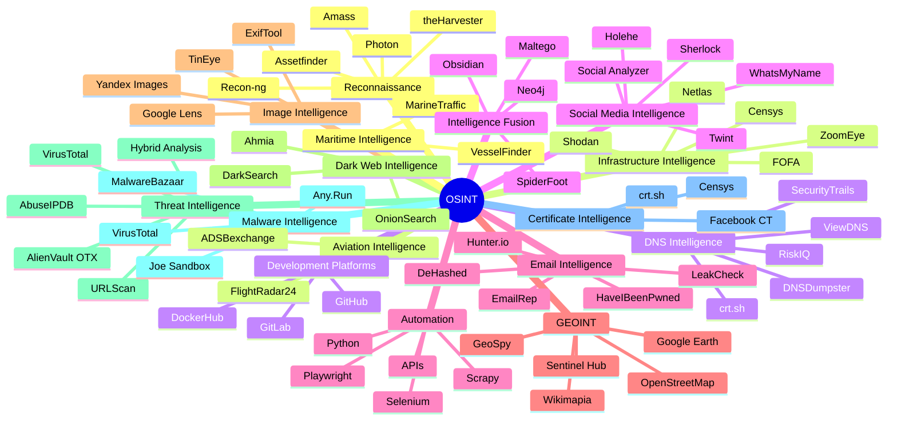
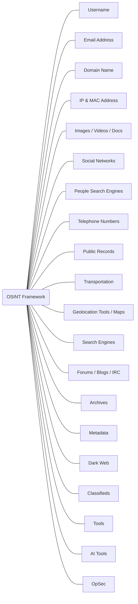

```text

                         ██████╗ ███████╗██╗███╗   ██╗████████╗
                        ██╔═══██╗██╔════╝██║████╗  ██║╚══██╔══╝
                        ██║   ██║███████╗██║██╔██╗ ██║   ██║   
                        ██║   ██║╚════██║██║██║╚██╗██║   ██║   
                        ╚██████╔╝███████║██║██║ ╚████║   ██║   
                         ╚═════╝ ╚══════╝╚═╝╚═╝  ╚═══╝   ╚═╝   
                                       
```
<div align="center">
    
# **`Awesome`** [Open](https://wikipedia.org/wiki/Open-source_intelligence) Source [Intelligence](https://www.sans.org/blog/what-is-open-source-intelligence/) (_[OSINT](https://osintframework.com/)_) [](https://awesome.re)
</div>

[](https://youtube.com/playlist?list=PL9V4Zu3RroiUS6-mfp7AoK5Kbe0tCXzbz&si=X2LewjjbPhJcYAXc)
[](https://www.reddit.com/r/OSINT/new/)

<p align="center">
    <a href="https://github.com/cybersecurity-dev/"></a>
    &nbsp;
    <a href="https://www.youtube.com/@CyberThreatDefense"></a>
    &nbsp;
    <a href="https://cyberthreatdefence.com/my_awesome_lists"></a>
    
</p>



<details>
 
<summary>OSINT Framework</summary>


</details>
 


## 📖 Contents
- [Social Networks](#social-networks)
- [Mobile OSINT](#mobile-osint)
- [Cyber Threat Maps](#cyber-threat-maps)
- [My Other Awesome Lists](#my-other-awesome-lists)
- [Contributing](#contributing)
- [Contributors](#contributors)

### Social Networks

### Mobile OSINT

### Books
- [The OSINT Handbook: A practical guide to gathering and analyzing online information](https://www.amazon.com/OSINT-Handbook-practical-gathering-information-ebook/dp/B0CSSZ1JCL/)

### Cyber Threat Maps
- [Bitdefender Cyberthreat Real-Time Map](https://threatmap.bitdefender.com/) - Cyberthreat Real Time Map by [Bitdefender](https://www.bitdefender.com/).
- [Imperva Cyber Threat Attack Map](https://www.imperva.com/cyber-threat-attack-map/) - Cyber Threat Attack Map by [Thales](https://cds.thalesgroup.com/).
- [Kaspersky Cyberthreat Live Map](https://cybermap.kaspersky.com/) - Cyberthreat Live Map by [Kaspersky](https://www.kaspersky.com/).
- [Lionic Cyber Threat Map](https://www.lionic.com/threat-map/) - Cyber Threat Map by [Lionic ](https://www.lionic.com/company/about/)- Security Solution Provider.

### OSINT Frameworks
- [Maltego | OSINT & Cyber Investigations Platform](https://www.kali.org/tools/maltego/) - [Maltego](https://www.maltego.com/) is an open source intelligence and forensics application. It will offer you timous mining and gathering of information as well as the representation of this information in a easy to understand format.

### Other Awesome List
- [Awesome Hacker Search Engines](https://github.com/edoardottt/awesome-hacker-search-engines)


##

### My Other Awesome Lists
You can access the my other awesome lists [here](https://cyberthreatdefence.com/my_awesome_lists)

### Contributing
[Contributions of any kind welcome, just follow the guidelines](contributing.md)!

### Contributors
[Thanks goes to these contributors](https://github.com/cybersecurity-dev/awesome-open-source-intelligence/graphs/contributors)!

### License
[](http://creativecommons.org/publicdomain/zero/1.0)

[🔼 Back to top](#awesome-open-source-intelligence-osint-)

